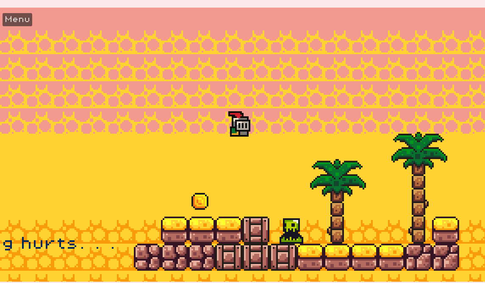

# Run Again

My first game made with Godot.

## About

Run Again is a simple 2D platformer where you jump across platforms, avoid obstacles and reach the portal to complete each level.

This is my first game, and I made it while learning Godot and game development.

## Controls

| Key | Action |
|---|---|
| W / Space | Jump |
| A / Left Arrow | Move left |
| D / Right Arrow | Move right |

## Built with

- Godot Engine
- GDScript

## Play the game

[Play Run Again on itch.io](https://raphelreji.itch.io/run-again)

## Windows Release

[Download Run Again for Windows](https://github.com/RaphelReji/my-first-game/releases/tag/v1.0.0)

Download the ZIP, extract it and run the game.

## Screenshot

## Credits

- **Tutorial:** [Brackeys - How to make a Video Game](https://www.youtube.com/watch?v=LOhfqjmasi0)
- **Asset Pack:** [Brackeys Platformer Bundle](https://brackeysgames.itch.io/brackeys-platformer-bundle)

This game was made as a learning project while I was learning Godot. I used the tutorial and asset pack as learning resources while building Run Again.

